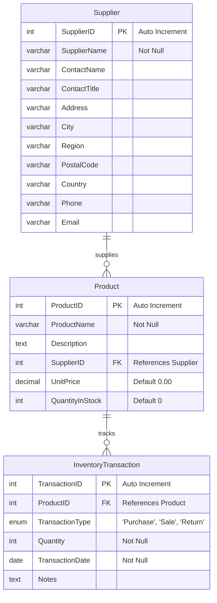

# 📦 Inventory Management System

> **Project Statement 2 — L&T EduTech**  
> A complete, production-grade Inventory Management System built with **Python Flask**, **MySQL 8.4**, and **Aiven Cloud**, deployed live on **Vercel**.

---

## 🌐 Live Website & Links

* 🔗 **Live Web Application**: [https://inventorymanagement-lake.vercel.app](https://inventorymanagement-lake.vercel.app)
* 🗄️ **Database**: Aiven Cloud MySQL 8.4 (`defaultdb`) with SSL/TLS Encryption
* 📁 **Complete SQL Script**: [`inventory_management.sql`](./inventory_management.sql)

---

## 📌 Project Overview

This system provides end-to-end inventory tracking including product cataloging, supplier management, and stock transaction recording (Purchases, Sales, and Returns).

### Key Features
* 🛒 **Product Catalog**: Add, edit, delete, and view products with unit pricing, stock levels, and linked suppliers.
* 🏭 **Supplier Directory**: Manage vendor details, contacts, addresses, and track items supplied.
* 📋 **Transaction Tracking**: Log Purchases, Sales, and Returns with automatic date stamping and notes.
* ⚡ **1-Click Quick Stock Stepper**: `[-]` and `[+]` quick adjustments right from the dashboard table.
* 📊 **Stock Movement Analytics**: Visual bar graphs tracking Purchased vs. Sold vs. Returned quantities per product.
* ⚠️ **Low-Stock Detection**: Real-time alerts for products falling below the safety threshold (< 50 units).
* 💰 **Inventory Valuation**: Automatic calculation of individual and total asset inventory value.

---

## 🗄️ Database Architecture & Schema

### Entity-Relationship Diagram (ERD)



---

## 📋 Table Specifications

### 1. `Supplier` Table
| Column | Type | Constraint | Description |
|---|---|---|---|
| `SupplierID` | `INT` | `PRIMARY KEY AUTO_INCREMENT` | Unique identifier for supplier |
| `SupplierName` | `VARCHAR(150)` | `NOT NULL` | Company / Supplier name |
| `ContactName` | `VARCHAR(100)` | Nullable | Primary contact person |
| `ContactTitle` | `VARCHAR(100)` | Nullable | Designation (e.g., Sales Manager) |
| `Address` | `VARCHAR(200)` | Nullable | Office / Warehouse address |
| `City` | `VARCHAR(100)` | Nullable | City |
| `Region` | `VARCHAR(100)` | Nullable | State / Region |
| `PostalCode` | `VARCHAR(20)` | Nullable | PIN / Postal code |
| `Country` | `VARCHAR(100)` | Nullable | Country |
| `Phone` | `VARCHAR(30)` | Nullable | Contact phone number |
| `Email` | `VARCHAR(150)` | Nullable | Email address |

### 2. `Product` Table
| Column | Type | Constraint | Description |
|---|---|---|---|
| `ProductID` | `INT` | `PRIMARY KEY AUTO_INCREMENT` | Unique product identifier |
| `ProductName` | `VARCHAR(150)` | `NOT NULL` | Name of the product |
| `Description` | `TEXT` | Nullable | Product specifications/notes |
| `SupplierID` | `INT` | `FOREIGN KEY (Supplier.SupplierID)` | Vendor providing the product |
| `UnitPrice` | `DECIMAL(10,2)` | `NOT NULL DEFAULT 0.00` | Price per single unit in ₹ |
| `QuantityInStock` | `INT` | `NOT NULL DEFAULT 0` | Available stock in warehouse |

### 3. `InventoryTransaction` Table
| Column | Type | Constraint | Description |
|---|---|---|---|
| `TransactionID` | `INT` | `PRIMARY KEY AUTO_INCREMENT` | Unique transaction ID |
| `ProductID` | `INT` | `FOREIGN KEY (Product.ProductID)` | Associated product |
| `TransactionType` | `ENUM` | `('Purchase', 'Sale', 'Return')` | Type of movement |
| `Quantity` | `INT` | `NOT NULL` | Units moved |
| `TransactionDate` | `DATE` | `NOT NULL` | Date of transaction |
| `Notes` | `TEXT` | Nullable | Order notes, client name, etc. |

---

## 🔍 SQL Queries Included in `inventory_management.sql`

* **Q1**: Product catalog joined with Supplier details (`LEFT JOIN`)
* **Q2**: Insert new product into catalog
* **Q3**: Update quantity in stock for restocking
* **Q4 & Q5**: Insert purchase and sale transactions with current dates
* **Q6**: Trace complete audit trail for a single product
* **Q7**: Aggregate stock movements (`SUM` by transaction type: Purchased vs. Sold vs. Returned)
* **Q8**: Safety threshold low-stock warning report (`QuantityInStock < 50`)
* **Q9**: Vendor performance report with total distinct products supplied
* **Q10 & Q11**: Itemized inventory valuation & overall warehouse asset value
* **Q12**: Monthly transaction aggregation report
* **Q13 & Q14**: Supplier record management and updates

---

## 🛠️ Project Directory Structure

```text
inventory_management/
├── api/
│   └── index.py             # Vercel serverless backend & Flask routes
├── app.py                   # Local Flask runner
├── ca.pem                   # Aiven SSL CA certificate
├── inventory_management.sql # Complete SQL script (DDL + DML + 14 Queries)
├── setup_db.py              # Python migration script to seed Aiven DB
├── requirements.txt         # Dependencies (Flask, mysql-connector-python)
├── vercel.json              # Vercel deployment configuration
└── README.md                # Project documentation & live links
```

---

## 💻 Running Locally

1. **Clone or extract** the project files.
2. **Install dependencies**:
   ```bash
   pip install -r requirements.txt
   ```
3. **Start the application**:
   ```bash
   python app.py
   ```
4. **Open in browser**:
   👉 `http://localhost:5000`

---

## 🚀 Deployment

The project is deployed on **Vercel** serverless functions with a live connection to **Aiven Cloud MySQL 8.4** over encrypted TLS.

* **Live URL**: [https://inventorymanagement-lake.vercel.app](https://inventorymanagement-lake.vercel.app)
